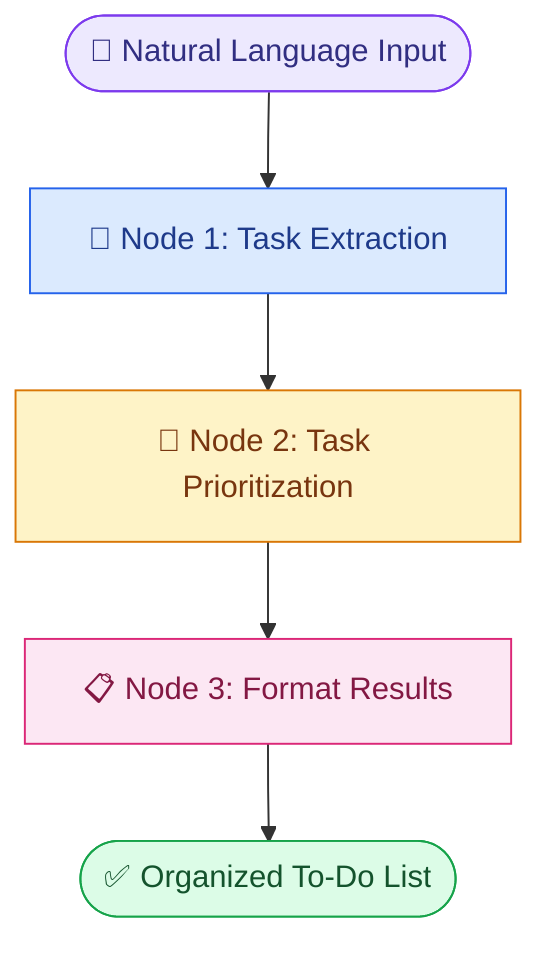

<div align="center">

# 📝 TaskFlow AI

### ✨ From Messy Thoughts to an Organized Day

<p>
  
</p>

<p>
  
  
  
  
</p>

**An AI-powered task organizer that transforms everyday language into a clear, prioritized to-do list.**

</div>

---

## 🌟 Overview

Ever feel like your mind is full of tasks, deadlines, and plans?

TaskFlow AI helps turn those thoughts into an organized action list. Simply describe what you need to do in natural language, and the AI extracts individual tasks, assigns priorities, and displays the results in a clean web interface.

### 💬 Example input

> I need to finish my assignment tomorrow, buy groceries today, and prepare for my meeting next week.

### ⚡ What TaskFlow AI does

- 🧠 Extracts individual tasks from natural-language input
- 🔥 Assigns **High**, **Medium**, or **Low** priorities
- 📋 Organizes tasks into a readable list
- 🔄 Uses LangGraph to manage the AI workflow
- 🖥️ Provides a simple interface powered by Streamlit

---

## 🎬 How It Works



### 🔹 Node 1 — Task Extraction
Groq AI identifies individual tasks from the user's message.

### 🔹 Node 2 — Task Prioritization
The AI assigns a priority based on urgency, importance, and any deadlines mentioned.

### 🔹 Node 3 — Format Results
The workflow formats tasks into a clear list, placing higher-priority tasks first.

---

## ✨ Features

| Feature | Description |
|---|---|
| 💬 Natural-language input | Describe tasks in your own words |
| 🧠 AI task extraction | Convert one message into separate tasks |
| 🔴 Priority labels | Identify High, Medium, and Low priorities |
| 📊 Smart organization | Sort tasks by priority |
| 🔗 LangGraph workflow | Run each processing step in sequence |
| 🖥️ Interactive interface | Enter tasks through a Streamlit web app |

---

## 🛠️ Tech Stack

<p>
  
  
  
  
  
</p>

- **Python** — core application logic
- **Groq API** — language model inference
- **LangChain Groq** — integration with the Groq model
- **LangGraph** — multi-step workflow orchestration
- **Streamlit** — web application interface
- **python-dotenv** — environment variable management

---

## 📁 Project Structure

```text
TaskFlowAI/
│
├── src/
│   ├── __init__.py
│   ├── state.py
│   ├── agents.py
│   └── graph.py
│
├── static/
│
├── app.py
├── .env
├── .env.example
├── .gitignore
├── requirements.txt
└── README.md
```

---

## 🚀 Getting Started

Follow these steps to run TaskFlow AI locally.

### 1️⃣ Clone the repository

```bash
git clone https://github.com/YOUR_USERNAME/TaskFlowAI.git
cd TaskFlowAI
```

Replace `YOUR_USERNAME` with your GitHub username after creating your repository.

### 2️⃣ Create a virtual environment

```bash
python -m venv .venv
```

**Windows PowerShell:**

```powershell
.venv\Scripts\Activate.ps1
```

### 3️⃣ Install dependencies

```bash
python -m pip install --upgrade pip
pip install -r requirements.txt
```

### 4️⃣ Configure your Groq API key

Create a `.env` file in the project root:

```env
GROQ_API_KEY=your_actual_groq_api_key
```

Get your API key from [Groq Console](https://console.groq.com/).

> 🔐 Security: Never commit your `.env` file or expose your API key in screenshots, source code, or public repositories.

### 5️⃣ Launch the application

```bash
streamlit run app.py
```

Your browser should open the local TaskFlow AI web application.

---

## 🧪 Example Output

**Input:**

```text
I need to submit my assignment tomorrow,
clean my room this weekend,
and read a book when I have free time.
```

**Illustrative output:**

| Priority | Task |
|---|---|
| 🔴 High | Submit my assignment tomorrow |
| 🟡 Medium | Clean my room this weekend |
| 🟢 Low | Read a book in my free time |

*Example priorities are illustrative; actual AI classifications may differ.*

---

## 🔐 Responsible AI & Limitations

- AI-generated priorities may not always reflect the user's actual preferences.
- Review task labels and explanations before relying on them.
- The application does not automatically schedule reminders or calendar events.
- Model availability and API limits depend on the Groq account.
- Never place API credentials in public repositories.

---

## 🔮 Future Improvements

- [ ] Mark tasks as completed
- [ ] Allow users to edit AI-assigned priorities
- [ ] Add task categories and filters
- [ ] Save tasks between sessions
- [ ] Add due-date and reminder support
- [ ] Export the to-do list to CSV
- [ ] Add a task history dashboard

---

## 👩‍💻 Author

**Nargis Nizam**

AI & Data Science Student | Python Developer

<p>
  <a href="https://github.com/NargisNizam">
    
  </a>
</p>

---

<div align="center">

### 💜 Plan Better. Prioritize Smarter. Get Things Done.

*Built with Python, Groq AI, and LangGraph.*

</div>
